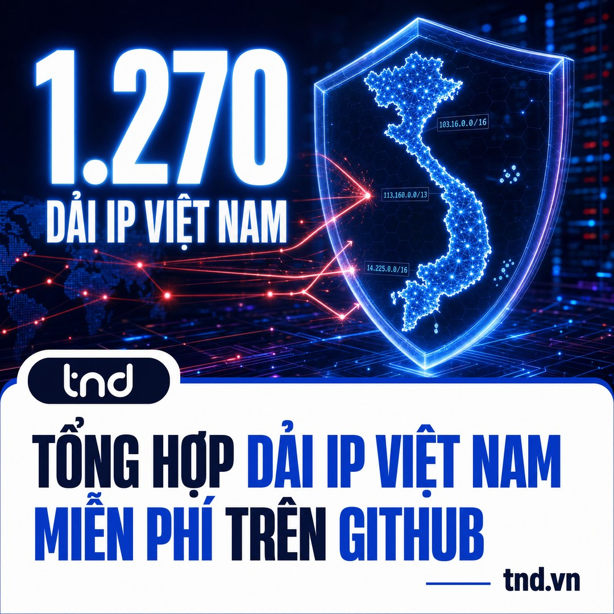

# Dải IP Việt Nam - Danh sách địa chỉ IP Việt Nam (IPv4 + IPv6) cập nhật hàng tuần

<p align="center"></p>

**Tổng hợp dải IP Việt Nam** đầy đủ, đã gộp gọn, sẵn sàng dùng để **chỉ cho phép (allow) IP Việt Nam truy cập, chặn toàn bộ IP nước ngoài** (deny all) trên máy chủ, VPS, tường lửa, router. Danh sách được **tổng hợp bởi [TND](https://www.tnd.vn)** và tự động cập nhật mỗi thứ Hai.

| | Số lượng |
|---|---|
| Dải IPv4 Việt Nam (đã gộp) | **1.270** dải CIDR |
| Tổng địa chỉ IPv4 Việt Nam | **~16,5 triệu** địa chỉ |
| Dải IPv6 Việt Nam (đã gộp) | **949** dải CIDR |

> Số liệu tại thời điểm 30/10/2026. Xem số mới nhất trong [`meta.json`](meta.json).

## Mục lục

- [Tải danh sách IP Việt Nam](#tải-danh-sách-ip-việt-nam)
- [Khi nào nên chỉ cho phép IP Việt Nam truy cập?](#khi-nào-nên-chỉ-cho-phép-ip-việt-nam-truy-cập)
- [Ví dụ: NAS Synology mở ra Internet](#ví-dụ-nas-synology-mở-ra-internet)
- [Cách chặn IP nước ngoài, chỉ cho phép IP Việt Nam](#cách-chặn-ip-nước-ngoài-chỉ-cho-phép-ip-việt-nam)
  - [iptables + ipset (Linux)](#1-iptables--ipset-linux)
  - [nftables (Linux)](#2-nftables-linux)
  - [UFW (Ubuntu)](#3-ufw-ubuntu)
  - [Nginx](#4-nginx)
  - [Apache / .htaccess](#5-apache--htaccess)
  - [CSF Firewall (cPanel, DirectAdmin)](#6-csf-firewall-cpanel-directadmin)
  - [MikroTik RouterOS](#7-mikrotik-routeros)
  - [Windows Server / Remote Desktop](#8-windows-server--remote-desktop-rdp)
  - [Cloudflare](#9-cloudflare)
- [Lưu ý quan trọng trước khi chặn IP nước ngoài](#lưu-ý-quan-trọng-trước-khi-chặn-ip-nước-ngoài)
- [Câu hỏi thường gặp](#câu-hỏi-thường-gặp)
- [Góp ý, bổ sung](#góp-ý-bổ-sung)

## Tải danh sách IP Việt Nam

Mỗi file là danh sách **dải IP Việt Nam** dạng CIDR, mỗi dòng một dải:

| File | Nội dung | Link tải trực tiếp (raw) |
|---|---|---|
| [`vn-ipv4.txt`](vn-ipv4.txt) | Dải IPv4 Việt Nam | `https://raw.githubusercontent.com/tnd-vn/dai-ip-viet-nam/main/vn-ipv4.txt` |
| [`vn-ipv6.txt`](vn-ipv6.txt) | Dải IPv6 Việt Nam | `https://raw.githubusercontent.com/tnd-vn/dai-ip-viet-nam/main/vn-ipv6.txt` |
| [`vn-all.txt`](vn-all.txt) | IPv4 + IPv6 | `https://raw.githubusercontent.com/tnd-vn/dai-ip-viet-nam/main/vn-all.txt` |
| [`vn-ipv4.csv`](vn-ipv4.csv) | CIDR, IP đầu, IP cuối, số IP (mở bằng Excel / Google Sheets) | `https://raw.githubusercontent.com/tnd-vn/dai-ip-viet-nam/main/vn-ipv4.csv` |

File cấu hình dựng sẵn trong thư mục [`formats/`](formats):

| File | Dùng cho |
|---|---|
| [`ipset-vn.txt`](formats/ipset-vn.txt) | iptables + ipset (`ipset restore`) |
| [`nftables-vn.nft`](formats/nftables-vn.nft) | nftables (set `vn4`, `vn6`) |
| [`nginx-allow-vn.conf`](formats/nginx-allow-vn.conf) | Nginx `allow` / `deny all` |
| [`apache-require-vn.conf`](formats/apache-require-vn.conf) | Apache 2.4 `Require ip` |
| [`mikrotik-vn.rsc`](formats/mikrotik-vn.rsc) | MikroTik address-list `VN` |
| [`windows-firewall-vn.ps1`](formats/windows-firewall-vn.ps1) | Windows Firewall (RDP 3389) |

Tải nhanh bằng lệnh:

```bash
curl -fsSL https://raw.githubusercontent.com/tnd-vn/dai-ip-viet-nam/main/vn-ipv4.txt -o vn-ipv4.txt
```

## Khi nào nên chỉ cho phép IP Việt Nam truy cập?

Allow IP Việt Nam + deny all (chỉ cho phép IP Việt Nam, chặn phần còn lại) **chỉ thực sự cần thiết khi đủ cả hai điều kiện**:

1. Thiết bị hoặc dịch vụ **chỉ có người dùng ở Việt Nam** (nhân viên, gia đình, đối tác trong nước).
2. **Không cần Google hay bất kỳ dịch vụ nước ngoài nào truy cập vào**, tức không cần lên kết quả tìm kiếm, không nhận webhook từ nước ngoài.

Khi đó, chặn cả thế giới gần như không mất gì, nhưng cắt bỏ được phần lớn các đợt quét tự động và khai thác lỗ hổng đến từ IP nước ngoài, nhất là trong khoảng thời gian từ lúc lỗ hổng được công bố đến lúc bạn kịp cập nhật.

Ví dụ điển hình:

- **NAS** (Synology, QNAP, TrueNAS) mở DSM / File Station / Drive ra Internet cho nhân viên làm việc từ xa. Xem [ví dụ chi tiết bên dưới](#ví-dụ-nas-synology-mở-ra-internet).
- **Camera / đầu ghi** (NVR, DVR) xem từ xa.
- **Remote Desktop (3389)**, **SSH (22)**, trang quản trị router, Proxmox (8006), Webmin.
- **Phần mềm kế toán, ERP, CRM nội bộ** chạy trên máy chủ riêng.
- **Tổng đài VoIP / SIP (5060)**, **VPN** (WireGuard, OpenVPN, L2TP) cho nhân viên.
- **Cơ sở dữ liệu** buộc phải mở ra ngoài: MySQL (3306), PostgreSQL (5432), SQL Server (1433).

**Không phù hợp** cho website bán hàng, blog, landing page cần SEO: chặn IP nước ngoài sẽ chặn luôn Googlebot và website sẽ rớt khỏi Google. Với các website này hãy dùng WAF, giới hạn tốc độ và cập nhật bản vá thay vì chặn theo quốc gia.

> Đây là **một lớp bảo vệ bổ sung**, không thay thế mật khẩu mạnh, xác thực 2 lớp, SSH key và cập nhật bản vá. Kẻ tấn công vẫn có thể dùng IP Việt Nam (VPS, proxy trong nước).

## Ví dụ: NAS Synology mở ra Internet

Một công ty nhỏ mở NAS Synology ra Internet (cổng 5000/5001) để nhân viên truy cập file khi ở nhà. Người dùng đều ở Việt Nam, NAS không cần Google index. Đây là trường hợp **nên** chỉ cho phép IP Việt Nam truy cập, vì chỉ riêng năm 2026 Synology đã công bố nhiều lỗ hổng có thể khai thác từ xa:

| Bản tin Synology | Công bố | Lỗ hổng | Mức độ | Bản vá |
|---|---|---|---|---|
| Synology-SA-26:13 (DSM) | 18/09/2026 | CVE-2026-13684 (SCGI), CVE-2026-13639 (đăng nhập): **không cần đăng nhập** vẫn đọc/ghi file tùy ý, làm treo NAS | Critical, CVSS 9.8 | DSM 7.2.1-69057-12, 7.2.2-72806-9, 7.3.2-86009-4, 7.4-90075 |
| Synology-SA-26:03 (telnetd) | 19/03/2026 | CVE-2026-32746: chạy lệnh từ xa không cần đăng nhập nếu bật Telnet | Critical, CVSS 9.8 | DSM 7.2.1-69057-11, 7.2.2-72806-8, 7.3.2-86009-3 |
| Synology-SA-26:14 (PHP2Shell) | 22/10/2026 | CVE-2026-109618, CVE-2026-109619 trong PHP: chạy mã từ xa qua các gói Calendar, Mail Station, PHP 7.3 đến 8.4 | Critical, CVSS 9.8 | Cập nhật gói tương ứng trong Package Center (PHP 7.3 không còn bản vá) |
| Synology-SA-26:06 (DSM) | 15/04/2026 | 11 lỗi (CVE-2026-40530 đến 40539, CVE-2026-4036): đọc/ghi file, lộ file chia sẻ | Important | DSM 7.2.1-69057-10, 7.2.2-72806-7, 7.3.2-86009-2 |

Nguồn: [trang Security Advisory của Synology](https://www.synology.com/en-global/security/advisory).

> **Khuyến nghị tốt nhất: đừng mở NAS ra Internet.** Hãy truy cập NAS qua VPN như [Tailscale](https://tailscale.com/kb/1131/synology) (không cần mở cổng) hoặc WireGuard dựng trên router. Khi NAS không lộ cổng nào, các lỗ hổng trên gần như không thể bị khai thác từ xa. Hướng dẫn chi tiết: [Bảo mật NAS Synology: dùng VPN thay vì mở ra Internet](https://www.tnd.vn/bao-mat-nas-synology-vpn-chan-ip-nuoc-ngoai-23815/).

Nếu buộc phải mở NAS ra Internet, làm theo thứ tự:

1. **Cập nhật DSM ngay**: Control Panel > Update & Restore. Đây là bước bắt buộc, chặn theo quốc gia chỉ là lớp phụ.
2. **Chỉ cho phép IP Việt Nam vào NAS**: Control Panel > Security > Firewall > Edit Rules, tạo luật **Allow** với Source IP chọn **Location: Vietnam**, đặt thêm luật Allow cho mạng LAN (ví dụ `192.168.0.0/16`), và ở phần hành động khi không khớp luật nào chọn **Deny access**. DSM xét luật từ trên xuống, dừng ở luật khớp đầu tiên: đừng để luật Allow cho mọi IP nằm trên luật chặn. DSM có sẵn dữ liệu quốc gia nên không cần nạp danh sách. Nếu NAS đứng sau router MikroTik hoặc tường lửa Linux, có thể chặn ngay ở router bằng [`mikrotik-vn.rsc`](formats/mikrotik-vn.rsc) hoặc [`ipset-vn.txt`](formats/ipset-vn.txt) để chặn trước khi gói tin tới NAS.
3. **Tắt Telnet và SSH** nếu không dùng: Control Panel > Terminal & SNMP.
4. **Bật chặn tự động** (Security > Protection > Auto Block) và **xác thực 2 lớp** cho mọi tài khoản quản trị.
5. **Cân nhắc QuickConnect**: kết nối qua máy chủ trung gian (relay) của Synology đi theo đường khác cổng mở trực tiếp, nên có thể không chịu luật tường lửa ở trên. Nếu muốn chặn chặt, hãy tắt QuickConnect và chỉ truy cập qua địa chỉ IP / tên miền riêng hoặc VPN.

## Cách chặn IP nước ngoài, chỉ cho phép IP Việt Nam

**Luôn thêm luật allow cho IP quản trị của bạn trước**, và giữ một phiên SSH/console đang mở khi áp dụng, để không tự khoá mình khỏi máy chủ.

### 1. iptables + ipset (Linux)

Cách nhanh và nhẹ nhất cho Linux, xử lý hàng nghìn dải IP mà không làm chậm máy:

```bash
# Cài ipset (Debian/Ubuntu: apt install ipset | CentOS/AlmaLinux: dnf install ipset)
curl -fsSL https://raw.githubusercontent.com/tnd-vn/dai-ip-viet-nam/main/formats/ipset-vn.txt -o /etc/ipset-vn.txt
ipset restore -exist < /etc/ipset-vn.txt

# Chỉ cho phép IP Việt Nam vào SSH, chặn mọi IP nước ngoài
iptables -I INPUT -p tcp --dport 22 -j DROP
iptables -I INPUT -p tcp --dport 22 -m set --match-set vn4 src -j ACCEPT
iptables -I INPUT -p tcp --dport 22 -s 203.0.113.10 -j ACCEPT   # IP quản trị của bạn (sửa lại)

ip6tables -I INPUT -p tcp --dport 22 -j DROP
ip6tables -I INPUT -p tcp --dport 22 -m set --match-set vn6 src -j ACCEPT
```

Muốn chặn toàn bộ IP nước ngoài (mọi cổng), thay `--dport 22` bằng quy tắc chung và nhớ cho phép `lo` và kết nối `ESTABLISHED,RELATED`.

### 2. nftables (Linux)

```bash
curl -fsSL https://raw.githubusercontent.com/tnd-vn/dai-ip-viet-nam/main/formats/nftables-vn.nft -o /etc/nftables.d/vn.nft
```

```nft
table inet filter {
    include "/etc/nftables.d/vn.nft"

    chain input {
        type filter hook input priority 0; policy accept;
        tcp dport 22 ip saddr 203.0.113.10 accept      # IP quản trị của bạn
        tcp dport 22 ip saddr @vn4 accept
        tcp dport 22 ip6 saddr @vn6 accept
        tcp dport 22 drop
    }
}
```

### 3. UFW (Ubuntu)

UFW không hỗ trợ ipset trực tiếp; thêm 1.270 rule sẽ chậm. Cách gọn: nạp ipset như mục 1 rồi thêm vào `/etc/ufw/before.rules` trước dòng `COMMIT`:

```
-A ufw-before-input -p tcp --dport 22 -m set --match-set vn4 src -j ACCEPT
-A ufw-before-input -p tcp --dport 22 -j DROP
```

Sau đó `ufw reload`. Cần nạp ipset trước khi UFW khởi động (ví dụ bằng gói `ipset-persistent` hoặc một systemd unit).

### 4. Nginx

```bash
curl -fsSL https://raw.githubusercontent.com/tnd-vn/dai-ip-viet-nam/main/formats/nginx-allow-vn.conf -o /etc/nginx/vn-allow.conf
```

Ví dụ Nginx làm reverse proxy cho NAS hoặc ứng dụng nội bộ (không cần Google index):

```nginx
server {
    listen 443 ssl;
    server_name nas.congty.vn;
    # ... ssl_certificate, ssl_certificate_key

    allow 192.168.0.0/16;             # mạng nội bộ
    include /etc/nginx/vn-allow.conf; # allow dải IP Việt Nam + deny all

    location / {
        proxy_pass https://192.168.1.10:5001;
    }
}
```

Kiểm tra rồi nạp lại: `nginx -t && systemctl reload nginx`.

### 5. Apache / .htaccess

Apache 2.4, đặt trong `<Directory>`, `<Location>` hoặc file `.htaccess`:

```bash
curl -fsSL https://raw.githubusercontent.com/tnd-vn/dai-ip-viet-nam/main/formats/apache-require-vn.conf -o /etc/apache2/vn-require.conf
```

```apache
<VirtualHost *:443>
    ServerName erp.congty.vn
    <Location />
        Include /etc/apache2/vn-require.conf
    </Location>
    # ... phần còn lại của ứng dụng nội bộ
</VirtualHost>
```

Với `.htaccess` (không dùng được `Include`), dán thẳng nội dung file [`apache-require-vn.conf`](formats/apache-require-vn.conf). LiteSpeed / OpenLiteSpeed đọc được cú pháp này.

### 6. CSF Firewall (cPanel, DirectAdmin)

CSF có sẵn tính năng chặn theo quốc gia (cần cấu hình nguồn GeoIP `CC_SRC` trong CSF). Trong `/etc/csf/csf.conf`:

```
CC_ALLOW_PORTS = "VN"
CC_ALLOW_PORTS_TCP = "22,2087,2222"
```

**Phải xoá các cổng này khỏi `TCP_IN`**, nếu không chúng vẫn mở cho mọi IP và luật theo quốc gia không có tác dụng.

Hoặc dùng danh sách của repo này (vẫn phải xoá cổng khỏi `TCP_IN`, vì `csf.allow` chỉ cho phép thêm chứ không chặn):

```bash
curl -fsSL https://raw.githubusercontent.com/tnd-vn/dai-ip-viet-nam/main/vn-ipv4.txt -o /etc/csf/vn-ipv4.txt
echo "Include /etc/csf/vn-ipv4.txt" >> /etc/csf/csf.allow
csf -r
```

Cách này cho phép IP Việt Nam vào **mọi cổng**, kể cả cổng đã đóng trong `TCP_IN`. Muốn chỉ mở một số cổng cho IP Việt Nam, dùng `CC_ALLOW_PORTS` ở trên.

### 7. MikroTik RouterOS

```
/tool fetch url="https://raw.githubusercontent.com/tnd-vn/dai-ip-viet-nam/main/formats/mikrotik-vn.rsc" dst-path=vn.rsc
/import file-name=vn.rsc
/ip firewall filter add chain=input in-interface-list=WAN protocol=tcp dst-port=8291,22 src-address-list=!VN action=drop comment="Chi cho IP Viet Nam vao Winbox/SSH"
```

`in-interface-list=WAN` là bắt buộc: thiếu nó, máy trong mạng LAN (192.168.x.x không nằm trong danh sách IP Việt Nam) cũng bị chặn Winbox. Router cấu hình mặc định đã có interface list `WAN`; nếu không có, thay bằng `in-interface=` cổng WAN của bạn. Chuỗi `comment` để không dấu vì RouterOS hiển thị Unicode không ổn định.

### 8. Windows Server / Remote Desktop (RDP)

Mở PowerShell bằng quyền Administrator, chạy [`windows-firewall-vn.ps1`](formats/windows-firewall-vn.ps1) để tạo rule cho phép IP Việt Nam vào cổng 3389. Sau đó **tắt rule Remote Desktop mặc định** (đang cho phép mọi IP) để chặn IP nước ngoài:

```powershell
# Cho phép mạng nội bộ (sửa lại dải LAN của bạn), nếu không máy trong LAN cũng bị chặn RDP
New-NetFirewallRule -DisplayName "Allow LAN RDP" -Direction Inbound -Action Allow -Protocol TCP -LocalPort 3389 -RemoteAddress 192.168.0.0/16
# Tắt rule mặc định đang cho phép mọi IP (Windows tiếng Anh; bản tiếng Việt tên nhóm có thể khác, xem trong wf.msc)
Disable-NetFirewallRule -DisplayGroup "Remote Desktop"
```

Nếu RDP chạy cổng khác 3389, sửa `-LocalPort` trong file trước khi chạy.

### 9. Cloudflare

Nếu tên miền đi qua Cloudflare (đám mây cam), máy chủ chỉ thấy IP của Cloudflare, nên chặn theo IP ở máy chủ sẽ không đúng. Hãy chặn ở Cloudflare: **Security > WAF > Custom rules**, áp dụng cho tên miền con của dịch vụ nội bộ (không áp cho website chính):

```
(ip.src.country ne "VN" and http.host eq "nas.congty.vn")
```

Action: **Block** hoặc **Managed Challenge**.

## Lưu ý quan trọng trước khi chặn IP nước ngoài

- **Đừng chặn website công khai** nếu cần SEO: Googlebot, Bingbot thu thập dữ liệu chủ yếu từ IP Mỹ. Chỉ chặn các thiết bị, dịch vụ dùng nội bộ trong nước.
- Khi bạn đi nước ngoài, dùng mạng di động roaming hoặc VPN, IP của bạn **không còn là IP Việt Nam**. Hãy có sẵn một đường vào dự phòng (VPN về văn phòng, console của nhà cung cấp VPS).
- Cổng thanh toán, webhook, API của dịch vụ quốc tế (PayPal, Stripe, Google, Facebook, GitHub...) gọi từ IP nước ngoài: hãy allow thêm IP của họ nếu chặn cổng web.
- Dữ liệu địa chỉ IP thay đổi theo thời gian (cấp mới, thu hồi). Cập nhật danh sách định kỳ, ví dụ cron hàng tuần:

```bash
17 3 * * 1 curl -fsSL https://raw.githubusercontent.com/tnd-vn/dai-ip-viet-nam/main/formats/ipset-vn.txt -o /etc/ipset-vn.txt && ipset restore -exist < /etc/ipset-vn.txt
```

## Câu hỏi thường gặp

### IP Việt Nam là gì?

IP Việt Nam là các địa chỉ IP được cấp cho tổ chức, doanh nghiệp, nhà mạng tại Việt Nam (VNPT, Viettel, FPT, CMC, các nhà cung cấp hosting, VPS và doanh nghiệp có vùng IP riêng). Khi truy cập Internet từ mạng trong nước, thiết bị của bạn thường mang một địa chỉ thuộc các dải này.

### Việt Nam có bao nhiêu địa chỉ IP?

Khoảng **16,5 triệu địa chỉ IPv4** (1.270 dải sau khi gộp) và 949 dải IPv6. Con số cập nhật nằm trong [`meta.json`](meta.json).

### Làm sao kiểm tra một IP có phải IP Việt Nam không?

Trên Linux, sau khi nạp ipset ở mục 1:

```bash
ipset test vn4 113.161.1.1
```

Hoặc bằng Python:

```python
import ipaddress, urllib.request
vn = [ipaddress.ip_network(x) for x in urllib.request.urlopen(
    "https://raw.githubusercontent.com/tnd-vn/dai-ip-viet-nam/main/vn-ipv4.txt").read().decode().split()]
print(any(ipaddress.ip_address("113.161.1.1") in n for n in vn))
```

### Danh sách có chính xác 100% không?

Danh sách phản ánh các vùng địa chỉ được cấp phát cho Việt Nam. Một số ít IP có thể được dùng thực tế ở nước khác (doanh nghiệp đặt máy chủ ở nước ngoài) và ngược lại. Với mục đích chặn truy cập từ nước ngoài, độ chính xác này là đủ dùng; nếu phát hiện sai lệch, hãy góp ý theo mục bên dưới.

### Danh sách được cập nhật bao lâu một lần?

Tự động **mỗi thứ Hai** qua GitHub Actions ([`update.yml`](.github/workflows/update.yml)). Bạn cũng có thể tự chạy `python3 scripts/build.py` để tạo lại toàn bộ file.

## Góp ý, bổ sung

Danh sách **tổng hợp bởi TND**. Nếu bạn thấy dải IP Việt Nam nào còn thiếu, bị sai, hoặc cần thêm định dạng cấu hình khác (pfSense, FortiGate, Sophos, Juniper...), hãy:

- Mở [Issue](https://github.com/tnd-vn/dai-ip-viet-nam/issues) hoặc gửi Pull Request, hoặc
- Liên hệ góp ý trực tiếp với TND tại [www.tnd.vn/lien-he](https://www.tnd.vn/lien-he/).

Nếu repo hữu ích, hãy bấm **Star** để nhiều người cần chặn IP nước ngoài, chỉ cho phép IP Việt Nam tìm thấy hơn.

## Về TND

[TND](https://www.tnd.vn) là nhà cung cấp hạ tầng tại Việt Nam, vận hành máy chủ và dải IP riêng trong nước. Nếu bạn cần máy chủ đặt tại Việt Nam để áp dụng danh sách này, hoặc cần IP Việt Nam cố định để truy cập các hệ thống chỉ mở cho IP trong nước:

- **[VPS Việt Nam giá rẻ](https://www.tnd.vn/vps/)** - VPS NVMe đặt tại Việt Nam, tạo máy trong 60 giây, từ 129K/tháng.
- **[Proxy Việt Nam IPv4 riêng](https://www.tnd.vn/proxy-viet-nam/)** - IP tĩnh Việt Nam dùng riêng, 95K/tháng.
- **[Proxy IPv4 tĩnh Việt Nam và Mỹ](https://www.tnd.vn/proxy/)** - IP Việt Nam hoặc IP Mỹ dùng riêng.

---

Giấy phép [MIT](LICENSE). Tự do sử dụng, sửa đổi, chia sẻ; vui lòng giữ ghi chú "tổng hợp bởi TND".
